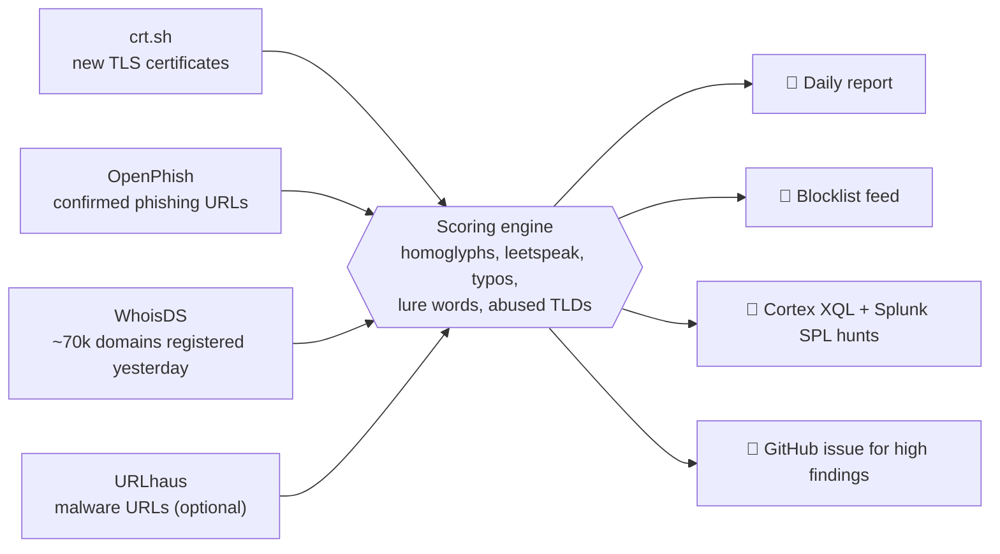

<h1 align="center">🛰️ Maghreb Threat Watch</h1>

<p align="center">
  <b>Open-source early warning for lookalike and phishing domains targeting North African brands.</b><br>
  Banks, telecoms, postal services and government portals in Tunisia, Morocco and Algeria.
</p>

<p align="center">
  
  
  
  
  
</p>

---

## Why this exists

Tunisia's national cybersecurity agency (ANCS) counted [558,000 cyberattacks in 2025, 168,000 of them phishing attempts](https://www.webmanagercenter.com/2026/06/05/567792/leconomie-tunisienne-sous-le-feu-des-hackers-lancs-sonne-lalarme-face-a-550-000-cyberattaques/), mostly run by organised, financially motivated networks. Yet almost all public threat intelligence is written for US and European brands. Nobody publishes a daily, technical, open feed of the fake BIAT, Poste Tunisienne, Ooredoo or BaridiMob sites that hit people here.

Maghreb Threat Watch does that, every morning, for free.

## What it does



1. **Collects** fresh domains and URLs from public sources (passive only: nothing is visited or scanned).
2. **Scores** each one against 45 brands with an explainable engine. Every point has a written reason.
3. **Publishes** a defanged daily report, a rolling blocklist, and **ready-to-paste hunting queries for Cortex XDR/XSIAM and Splunk**, so a SOC can check in minutes whether anyone already clicked.
4. **Alerts** by opening a GitHub issue with a triage checklist when something high-confidence appears.

## Example

```text
$ python -m mtw check biat.com.tn.verify-account.xyz xn--bit-login-1yh.com posterflex.com

biat.com.tn.verify-account.xyz: score 100 (high) -> BIAT [TN]
  - exact match on 'biat' in 'biat' (+50)
  - lure words ['account', 'verify'] (+20)
  - country hint ['tn'] (+10)
  - abused TLD .xyz (+10)
  - embeds official domain biat.com.tn (+20)
xn--bit-login-1yh.com: score 85 (high) -> BIAT [TN]
  displays as: biаt-login.com
  - homoglyph match on 'biat' in 'biаt' (+50)
  - deceptive spelling (+15)
  - lure words ['login'] (+15)
  - punycode domain (+5)
posterflex.com: no brand match
```

That second domain uses a **Cyrillic "а"**. It looks identical to the real thing in a browser bar. See a full sample report in [`examples/reports/LATEST.md`](examples/reports/LATEST.md).

## How the scoring works

A domain gets one **base match** (the strongest that applies) plus **context bonuses**. Score is capped at 100.

| Base match | Example | Points |
|---|---|---:|
| Exact brand token | `biat-login.xyz` | 50 |
| Homoglyph (look-alike Unicode letters) | `biаt-login.com` | 50 + 15 |
| Leetspeak | `b1at-tn.com`, `amenb4nk.net` | 48 + 15 |
| Long keyword inside a word | `myattijaribank.com` | 48 |
| Brand glued to known affixes or lures | `mybiat`, `biat24`, `biatsecurelogin` | 45 |
| Typosquat (1 or 2 edits on long names) | `attijarlbank`, `oredoo` | 38 |
| Short brand code as a whole word | `stb-tn-verification.com` | 25 |

| Context bonus | Points |
|---|---:|
| Real domain pasted inside a fake one (`biat.com.tn.evil.xyz`) | +20 |
| Lure words in EN/FR: `login`, `verify`, `colis`, `facture`, `remboursement`... | +15 to +25 |
| Country hint matching the brand (`tn`, `tunisie`, `dz`, `maroc`) | +10 |
| Heavily abused TLD (`.xyz`, `.top`, `.online`...) | +10 |
| Free hosting (`netlify.app`, `pages.dev`, `vercel.app`...) | +10 |
| Punycode | +5 |

**Severity:** high ≥ 70, medium ≥ 45, low ≥ 30. Short codes like `stb` or `cmi` are capped below the threshold unless a lure word or country hint is present.

### Built to stay quiet

Noise kills threat feeds. The engine is tuned on a real day of **70,000 newly registered domains**: it flags lookalikes while ignoring look-alike *words*. A naive substring search flags all of these; this tool flags none:

`posterflex.com` (poste) · `sibiatex.online` (biat) · `wafapartners.com` (wafa) · `laposte-livraison.com` (French La Poste) · `steg-sparvurtum.site` (German word) · `sncf-connect-login.com` (SNCF, not SNCFT) · `bankofamerica-login.vercel.app` (two edits from Bank of Africa)

Every false positive found becomes a regression test in [`tests/test_matcher.py`](tests/test_matcher.py).

## Quick start

```bash
git clone https://github.com/<you>/maghreb-threat-watch
cd maghreb-threat-watch
pip install -r requirements.txt

python -m mtw demo                                # offline demo on synthetic data
python -m mtw check biat-secure-login.xyz         # explain one domain
python -m mtw run --sources openphish,whoisds     # real run, writes reports/ feeds/ hunts/
python -m mtw run --sources none --input my_dns_export.txt   # score your own list
```

## Run it daily for free (GitHub Actions)

1. **Fork** this repository.
2. Go to **Actions** and enable workflows.
3. *(Optional)* Add a free [abuse.ch Auth-Key](https://auth.abuse.ch/) as a repository secret named `URLHAUS_AUTH_KEY` to enable URLhaus.
4. That's it. Every morning at 06:41 Tunis time the **Daily watch** workflow runs, commits the results, and opens an issue if it finds something high-confidence. Trigger it any time from **Actions → Daily watch → Run workflow**.

## Outputs

| Path | What | For whom |
|---|---|---|
| `reports/LATEST.md` | Today's defanged report with reasons | Analysts, readers |
| `reports/YYYY/MM/*.md` | Archive of every daily report | Trend analysis |
| `feeds/domains.txt` / `.csv` | Medium and high domains, rolling 30 days | Firewalls, DNS filters, TIPs |
| `hunts/latest.xql` | Cortex XDR / XSIAM query over DNS and network events | SOC teams on Palo Alto |
| `hunts/latest.spl` | Splunk `tstats` query on the CIM Network_Resolution model | SOC teams on Splunk |
| `data/findings.jsonl` | Full history with scores and reasons | Your own analysis |

Sample hunt for Cortex XDR:

```sql
config case_sensitive = false
| dataset = xdr_data
| filter event_type = ENUM.NETWORK
| filter dns_query_name ~= "(^|[.])(?:biat-secure-login[.]xyz|oredoo-recharge[.]xyz)$"
      or action_external_hostname ~= "(^|[.])(?:biat-secure-login[.]xyz|oredoo-recharge[.]xyz)$"
| fields _time, agent_hostname, actor_effective_username, actor_process_image_name,
         dns_query_name, action_external_hostname, action_remote_ip
| sort desc _time
```

## Coverage

**45 brands** across Tunisia (31), Morocco (9) and Algeria (5): 20 banks, 7 telecoms, 5 payment services, 3 postal services, plus government, utility and transport portals. Full list in [`config/brands.yml`](config/brands.yml).

**Add a brand** with a pull request: give it an `id`, distinctive `keywords`, any short `weak_keywords`, and its `official_domains` (never flagged). Add a positive and a negative case to `tests/test_matcher.py`, run `pytest`, done.

## Responsible use

- **Passive by design.** The tool only reads public feeds and certificate logs. It never visits, scans or interacts with suspected sites.
- **Defanged output.** Reports write `biat-login[.]xyz` so nobody clicks by accident. Raw domains appear only in the machine feeds and hunt queries.
- **A lead, not a verdict.** Scores are heuristics. Verify before blocking, and before naming anything publicly.
- **Report what you confirm** to the brand owner and to the national CERT (tunCERT at ANCS in Tunisia, maCERT at DGSSI in Morocco).
- Not affiliated with any of the brands listed. Brand names are used only to protect their customers.

## Roadmap

- [ ] Real-time mode on a VPS with the CertStream firehose
- [ ] Cortex MCP integration: let an AI analyst run the hunt query and summarise hits automatically
- [ ] Arabic and Tunisian Derja lure words, plus Libya and Mauritania brands
- [ ] Optional urlscan.io lookups for screenshots of confirmed sites
- [ ] Monthly "Maghreb Phishing Brief" built from the history

## Project layout

```text
config/          brands.yml, settings.yml (lures, TLDs, thresholds), allowlist.txt
mtw/             normalize (homoglyphs, leet), domains, matcher (scoring), pipeline, report, cli
mtw/collectors/  crt.sh, OpenPhish, WhoisDS, URLhaus, local files
tests/           80+ tests, including real-world false positives
.github/         daily watch and test workflows
```

## Author

Built by **[Rayen Skhiri](https://linkedin.com/in/rayen-skhiri)**, SOC Analyst L2/L3 and web application security engineer in Tunisia. CRTP. Questions, false positives or brands to add: open an issue.

<sub>MIT licensed. Data sources keep their own terms: crt.sh, OpenPhish community feed, WhoisDS free list, abuse.ch URLhaus.</sub>
